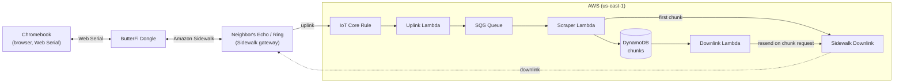

# ButterFi

ButterFi is a self-hosted Sidewalk-to-web bridge for constrained student
devices. This repo now centers on the Seeed XIAO nRF52840 Plus firmware track, the
browser tools around it, and the AWS backend that each owner deploys in their
own AWS account to serve chunked text responses over Amazon Sidewalk.

## Architecture



## Current Tracks

- Active firmware target: Seeed XIAO nRF52840 Plus in [firmware/xiao_nrf52840/](firmware/xiao_nrf52840)
- Student text-only browser: [web/browse.html](web/browse.html)
- Technical Web Serial console for the runtime device protocol: [web/index.html](web/index.html)
- Browser provisioning and web-flash prototype: [web/provision.html](web/provision.html)
- Cloud stack: [template.yaml](template.yaml)

## Ownership Model

ButterFi is intended to be buyer-owned and self-hosted. A buyer can purchase a
XIAO nRF52840 Plus, deploy [template.yaml](template.yaml) into their own AWS
account, register their own Sidewalk device, and use the browser provisioning
page to flash a prebuilt UF2 plus their device credential. This repo does not
assume a shared ButterFi-operated backend.

The concrete owner workflow is documented in
[docs/self-hosted-owner-setup.md](docs/self-hosted-owner-setup.md).

## Hardware

Use the **Seeed XIAO nRF52840 Plus** (or Plus Sense). The firmware transmits at
+8 dBm, which the Plus's FCC grant (Z4T-XIAO52840P, 0.006 W conducted) covers.
In-home coverage is ButterFi's main limit, and that power is what makes it work:
in testing from a house with no Amazon devices, the same spot that never
connected at 0 dBm and rarely at +4 dBm connected every time at +8 dBm. Don't
use the original XIAO nRF52840 — its grant (Z4T-XIAONRF52840) covers only about
+5 dBm.

The Plus's grant requires end users to be told how to keep RF exposure within
limits: keep the dongle at least 20 cm (8 in) from people while it's plugged
in — on the desk or on a USB extension cable, not in a lap.

## Protocol

The authoritative wire protocol — the USB framing between browser and dongle,
the Sidewalk frames between dongle and cloud, the provisioning frames, and the
status/error registries — lives in one place:
[docs/shared-protocol.md](docs/shared-protocol.md). In brief:

- **Browser ↔ dongle:** framed binary USB packets (sync bytes, version, type,
  request id, length, XOR checksum), not line-oriented JSON.
- **Dongle ↔ cloud (Sidewalk):** uplinks `0x01=query`, `0x02=resend`,
  `0x03=ack`; downlinks `0x81=response chunk`.
- **Responses** are chunked; the reassembled payload starts with a 1-byte format
  flag (`0x00` plain UTF-8, `0x01` gzip, `0x02` Brotli) that the dongle relays
  untouched and the browser decodes. Brotli is the normal format: a quarter to a
  third of the chunks a page would need as plain text, and about 20% fewer
  than gzip on real pages.

### Flow

1. Student types a query in the ButterFi PWA on their Chromebook
2. PWA sends query over Web Serial to the dongle
3. Dongle transmits uplink (type=0x01) over Sidewalk
4. IoT Core routes to Uplink Lambda → SQS → Scraper Lambda
5. Scraper fetches the page, strips it to text, compresses it (Brotli when smaller) behind a 1-byte format flag, and chunks the bytes into 236-byte pieces
6. Chunks stored in DynamoDB, first chunk sent as immediate downlink
7. Device receives chunk 0, forwards it to the browser, and requests more via type=0x02 with the next needed chunk index
8. Downlink Lambda reads from DynamoDB and sends next batch of chunks

## Firmware Build

The XIAO firmware build flow is documented in
[docs/xiao-build.md](docs/xiao-build.md).

The checked-in helper script is [scripts/build-xiao.sh](scripts/build-xiao.sh). If you are not already inside an nRF Connect SDK shell, point `NCS_ENV_JSON` at your local toolchain manager `environment.json` file before running it.

For quick post-flash USB sanity checks, the firmware guide also documents two optional probe scripts in [firmware/xiao_nrf52840/README.md](firmware/xiao_nrf52840/README.md).

The full real-hardware → real-Sidewalk → real-AWS round trip has been validated end to end: a dongle reached a neighbor's Sidewalk gateway and loaded a live page. The step-by-step checklist is in [docs/hardware-validation-checklist.md](docs/hardware-validation-checklist.md).

## Browser Tools

The browser-side tools are **hosted on GitHub Pages** (HTTPS, which Web Serial
requires) — operators and students just open a link in Chrome or Edge, no local
server:

- **Provision/flash dongles:** https://kevinl95.github.io/ButterFi/provision.html
- **Student browser:** https://kevinl95.github.io/ButterFi/browse.html
- **Technical console:** https://kevinl95.github.io/ButterFi/index.html

Source + local-dev instructions in [web/README.md](web/README.md). The three entry points:

- [web/browse.html](web/browse.html): the student-facing text-only browser — address bar, rendered ButterFi markup with clickable links, back navigation, a load-progress bar, Save PDF, and a New session button that clears history on shared devices
- [web/index.html](web/index.html): technical runtime serial console for the binary ButterFi protocol (status, manual resend, session log)
- [web/provision.html](web/provision.html): XIAO provisioning and web-flash prototype, with single-device self-hosted setup, optional batch-package support, and post-flash runtime config save over USB serial

## Deploy

Deployment is two halves: the **cloud** (one click) and the **devices**
(per-device Sidewalk provisioning, which no link can do for you).

### 1. Cloud — one click

[](https://console.aws.amazon.com/cloudformation/home?region=us-east-1#/stacks/create/review?templateURL=https%3A%2F%2Fbutterfi-deploy-us-east-1.s3.us-east-1.amazonaws.com%2Fbutterfi.yaml&stackName=butterfi)

Opens CloudFormation **in your own AWS account**, pre-loaded with the template —
review the parameters, check the IAM acknowledgment, and Create Stack. It stands
up the whole backend (Sidewalk destination, Lambdas, DynamoDB, IoT rules).
**Must be us-east-1** (Amazon Sidewalk is us-east-1-only) — the link pins it;
don't switch regions.

Prefer the CLI? Same template. It's larger than the 51,200 bytes CloudFormation
accepts directly, so `deploy` stages it in an S3 bucket of yours first; any
us-east-1 bucket works, and the first line creates one if you don't have one:

```bash
BUCKET="butterfi-cfn-$(aws sts get-caller-identity --query Account --output text)"
aws s3 mb "s3://$BUCKET" --region us-east-1   # once
aws cloudformation deploy \
  --template-file template.yaml \
  --s3-bucket "$BUCKET" \
  --stack-name butterfi \
  --capabilities CAPABILITY_IAM \
  --region us-east-1
```

### 2. Devices — Sidewalk provisioning

A Launch Stack link can't onboard Sidewalk devices (each needs its own
manufacturing credential + a device profile the stack doesn't create). After the
cloud is up:

1. Create a Sidewalk **device profile** in AWS IoT Wireless (us-east-1).
2. Bulk-create devices + credentials + a flashing batch with
   [scripts/bulk-provision-aws.py](scripts/bulk-provision-aws.py).
3. Flash + provision each dongle via [web/provision.html](web/provision.html).

Full walkthrough: [docs/self-hosted-owner-setup.md](docs/self-hosted-owner-setup.md)
and [docs/xiao-batch-provisioning.md](docs/xiao-batch-provisioning.md).

## Security checks

Static security + correctness checks run in CI (the **Security & correctness**
GitHub Action) and locally via the same script — they can't drift:

```bash
pip install -r scripts/security-requirements.txt   # cfn-lint, checkov, bandit
./scripts/security-scan.sh
```

- **cfn-lint** — CloudFormation validity (hard gate)
- **checkov** — CloudFormation security/misconfig (hard gate; accepted checks are
  documented in [.checkov.yaml](.checkov.yaml))
- **bandit** — Python SAST on the inline Lambda code (extracted from the
  `Code.ZipFile:` blocks) plus `scripts/` — HIGH severity gates the build;
  MEDIUM/LOW are advisory (e.g. the scraper's user-URL `urlopen` fetch surface,
  which is wrapped by an SSRF allow-guard that blocks private/loopback/metadata
  targets on every redirect hop).

## Parameters

| Parameter              | Default              | Description                                  |
|------------------------|----------------------|----------------------------------------------|
| SidewalkDestinationName| ButterFiDestination  | IoT Core Sidewalk destination name           |
| MaxChunkBytes          | 240                  | Max bytes per downlink chunk                 |
| ScraperTimeoutSeconds  | 30                   | Scraper Lambda timeout                       |
| ChunkTTLHours          | 2                    | Hours before DynamoDB TTL deletes page-content chunks (kept short for privacy) |

## Content policy (allowlist / blocklist)

Each school's stack has a `PolicyTable` (DynamoDB) of allowed / blocked domains,
enforced **server-side in the scraper** (per redirect hop too), so it can't be
bypassed by a modified client. Rules, in order:

1. a domain on the **block** list is always denied (block wins);
2. if the **allow** list is non-empty, only domains on it — and their subdomains
   — are reachable (allow-only mode);
3. otherwise the site loads.

An **empty policy is the default = open web**; schools opt into restriction by
adding domains. Matching covers subdomains (`example.com` also covers
`www.example.com`). Search keeps working in allow-only mode — a search result is
checked when the student opens it.

The safety checks fail closed. If the scraper can't read the policy table and has
no recent copy, it refuses the page instead of falling back to the open web. If
the Cloudflare for Families resolver can't be reached, nothing is fetched, rather
than resolving through an unfiltered DNS server. URLs typed as IP addresses are
refused, because the DNS filter can't judge them.

Edit it with `scripts/manage-policy.py` (needs `boto3` + AWS creds for the
school's account; resolves the table from the stack):

```bash
scripts/manage-policy.py block add ads.example doubleclick.net   # deny-list
scripts/manage-policy.py allow add wikipedia.org khanacademy.org # allow-only
scripts/manage-policy.py allow list                              # inspect
scripts/manage-policy.py block remove ads.example                # undo
```

Changes take effect within ~60s (the scraper caches the policy).

## Privacy

ButterFi is built to collect as little as possible about the students who use
it, and everything it does collect stays in the school's own AWS account. In
short: websites never see the student (the scraper fetches on their behalf), the
Sidewalk payload is encrypted so the relaying gateway can't read it, the browser
keeps history in memory only (no cookies/trackers; a **New session** button
clears it on shared devices), search/URL text is never logged or stored, and
page content in DynamoDB auto-deletes within `ChunkTTLHours` (default 2h). Logs
keep operational metadata only, for 7 days.

Full data-practices statement for schools and families: [PRIVACY.md](PRIVACY.md).

## Scaling Notes

- **DynamoDB**: PAY_PER_REQUEST mode scales automatically. No capacity planning needed.
- **SQS**: Decouples uplink processing from scraping. Scraper can take 15-30s per request
  without blocking the uplink handler.
- **Lambda concurrency**: Default account limits apply. For large deployments, request
  concurrency increases for the scraper Lambda.
- **Sidewalk rate limits**: The network itself is the bottleneck, not the backend.
  Downlink chunks are sent in small batches (3 at a time) to respect Sidewalk's
  rate enforcement.
- **Dead letter queue**: Failed scrapes land in the DLQ after 3 retries. CloudWatch
  alarm fires if messages accumulate.

## Cost Estimate (1,000 students, ~10 queries/day each)

- Lambda: ~$2-5/month (short invocations, small memory)
- DynamoDB: ~$1-3/month (on-demand, TTL keeps table small)
- SQS: ~$0.50/month
- IoT Core: Free tier covers Sidewalk message routing
- **Total: ~$5-10/month** (excluding any LLM API costs if you add one later)

## Future Enhancements

- [ ] Add LLM endpoint for direct question answering (skip scraping entirely)
- [ ] ButterFi-native content format for teacher-created pages
- [ ] Static site generator for ButterFi-optimized content
- [ ] Content caching layer (popular queries served from cache, no re-scrape)
- [ ] Usage analytics dashboard for school administrators (must aggregate /
      anonymize — do not surface per-student browse history; see [PRIVACY.md](PRIVACY.md))
- [ ] OTA firmware update delivery over Sidewalk